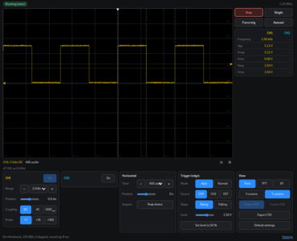
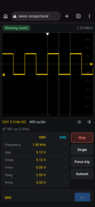
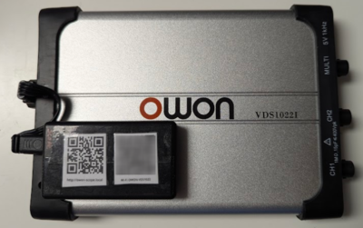

# OWON VDS1022I Wi-Fi sidekick

Use an OWON VDS1022/VDS1022I USB oscilloscope from any phone, tablet or computer, with no driver and no app: an ESP32-S3 board drives the scope over USB and serves a web app over Wi-Fi.

> **Disclaimer:** this is a quick personal project, vibe-coded with [Claude Code](https://claude.com/claude-code) (Claude Opus 5.5). It is provided as is, with no support and no warranty. Issues and pull requests may go unanswered.

Features: run/stop/single/auto-set, both channels, time bases down to 5 ns/div, edge trigger with draggable markers, measurements, cursors, FFT, XY, roll mode, CSV and PNG export, light and dark themes, settings shared between browsers, firmware updates over Wi-Fi. What is left compared to OWON's own app: [docs/FEATURES.md](docs/FEATURES.md).

[](docs/screenshot-desktop.png)
[](docs/screenshot-mobile.png)

## Hardware

[](docs/scope-with-board.png)

- ESP32-S3 dev board with two USB-C ports and 16 MB flash / 8 MB octal PSRAM (N16R8), such as the ESP32-S3-DevKitC-1 clones based on the YD-ESP32-S3 layout.
- Close the board's **USB-OTG** solder bridge so its native USB port powers the scope. Never plug that port into a computer afterwards.
- Bridge diode **D1** next to the COM port ([photo](docs/board-d1.jpg)): through it the scope's voltage is too low and it never shows up. Then power the board from the COM port only.
- Native USB port → scope (USB-A to USB-C cable). COM port ← any USB-C 5 V source of about 1 A: brick, power bank, phone.

A weak source shows up at start-up: the scope drops off USB right after its FPGA is loaded. Details in [docs/PROJECT.md](docs/PROJECT.md).

## Build

Needs ESP-IDF v5.2 and Node.js (the web app is bundled at build time).

1. Clone [florentbr/OWON-VDS1022](https://github.com/florentbr/OWON-VDS1022) next to `firmware/`, as `OWON-VDS1022/`. The scope's FPGA forgets its configuration at every power-up, and the firmware embeds OWON's FPGA files from that clone to load it. They are not part of this repository.
2. Copy `firmware/main/wifi_secrets.h.example` to `firmware/main/wifi_secrets.h` and set the password of the board's own network.
3. Build and flash through the COM port the first time:
   ```bash
   cd firmware
   idf.py build flash
   ```

Later updates go over Wi-Fi, from the settings page or with:

```bash
curl -X POST --data-binary @build/owon_sidekick.bin http://owon-scope.local/update
```

Do not share built binaries: they contain OWON's FPGA files.

## Use

1. Join the board's network `OWON-VDS1022` with the password from `wifi_secrets.h`. The page opens at `http://192.168.4.1/`.
2. Optional: on the settings page (`/settings`), join your own network. The board then also answers at `http://owon-scope.local/` and keeps its own network.

To stick on the box: [docs/owon-scope-qr.svg](docs/owon-scope-qr.svg) opens `http://owon-scope.local/`. A second QR code to join the board's network is worth making too, for example with `qrencode -o firmware/wifi_qr.png 'WIFI:T:WPA;S:OWON-VDS1022;P:<password>;;'`. It holds the password, so it stays out of git (`firmware/wifi_qr.png` is ignored).

## Layout

| Path | Contents |
|---|---|
| `firmware/main/` | ESP-IDF firmware: USB host and scope protocol, Wi-Fi, web server, WebSocket stream, OTA |
| `firmware/web/` | Web app (OWL 2), bundled by `build.mjs` |
| `firmware/test/` | Tests for the web app's logic: `node --test firmware/test/*.mjs` |
| `docs/` | Development notes and the feature list |

## Credits and license

The scope protocol comes from [florentbr/OWON-VDS1022](https://github.com/florentbr/OWON-VDS1022). OWL is under the LGPL ([firmware/web/lib/OWL_LICENSE](firmware/web/lib/OWL_LICENSE)). This project is not affiliated with OWON.

The rest is under the MIT license: [LICENSE](LICENSE).
